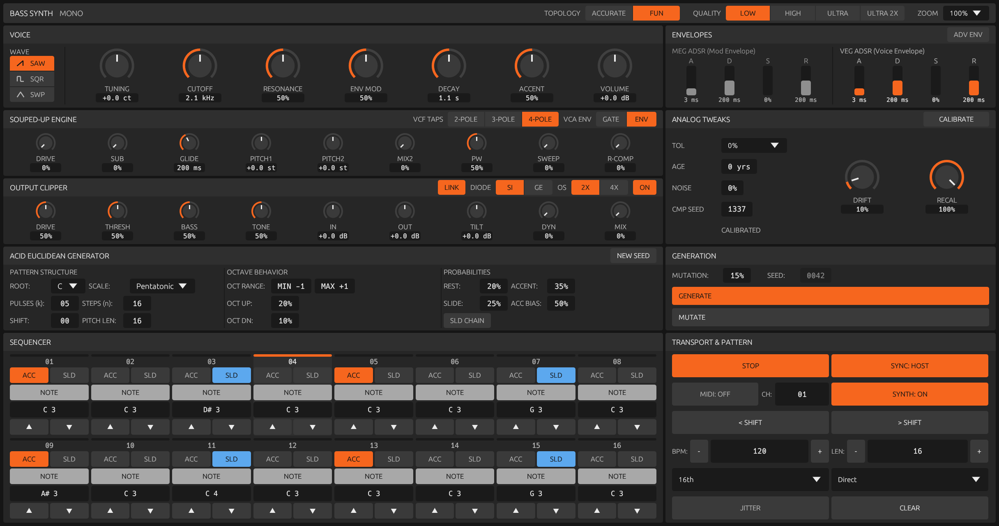

# vibe303: Souped-up TB-303

Circuit-grounded emulation of the Roland TB-303 bass synthesizer, built in Rust with [nih-plug](https://github.com/robbert-vdh/nih-plug) and [egui](https://github.com/emilk/egui). The analog core is validated against ngspice. The plugin has four quality tiers, a decoupled 16-step sequencer, a Euclidean acid pattern generator, a germanium JFET output clipper, and a "Souped-Up" engine that adds the controls the hardware never had.

- **Version:** 0.1.0
- **Formats:** VST3, CLAP, Standalone
- **Platforms:** macOS (Apple Silicon), Linux (x86_64 AVX2), Windows (x86_64)

---



The editor is 1216x640 points. The image above is rendered offscreen from the real editor code (`tools/gui_render`, state `running_note`).

---

## Features

### 1. Circuit modeling and quality tiers

The VCO and VCF are modeled as circuit IR (`circuit/*.toml`), emitted to SPICE, and checked against ngspice. Low, High, and Best solve the filter as a nodal system (MNA with a Newton solver in `f64`), not as a wave digital filter. High and Best also solve the oscillator from the circuit.

|Tier|Oscillator|Filter|Oversampling|
|---|---|---|---|
|**Draft**|PolyBLEP saw|TPT diode-ladder approximation|none|
|**Low**|PolyBLEP saw|Nodal diode ladder with active Q9 resonance|2x|
|**High**|Nodal relaxation VCO at the base rate|Nodal diode ladder|2x|
|**Best**|Nodal relaxation VCO (21 nodes)|Nodal diode ladder with active Q9 resonance|4x|

- Tier switches use a 10 ms equal-power crossfade, so they do not click.
- Plugin delay compensation is the same for every tier. The host never has to rebuild its graph when you change tier.
- Measured CPU per voice: Best ~147% of one core (offline-grade), Low ~42%. High is not profiled. Use Draft or Low for tracking, Best for bounces.

### 2. Topology: Accurate and Fun

- **Accurate:** hardware behavior. Fixed 4-pole filter, no drive, no second oscillator, no sub, fixed 50% pulse width, Sweep wave falls back to Saw, simple envelopes, pitch limited to MIDI 24 to 72. The SOUPED-UP ENGINE device dims its controls.
- **Fun:** unlocks the Souped-Up engine and widens the pitch range to MIDI 0 to 108. Fun is the default.

### 3. Voice

- **Oscillators:** Saw, Square, and a continuous Saw to Square Sweep. Souped-Up adds a second oscillator with pitch and mix, a sub oscillator, pulse width, and sweep.
- **Filter:** diode ladder with switchable 2-pole (12 dB/oct), 3-pole (18 dB/oct), and 4-pole (24 dB/oct) taps, plus drive and resonance gain compensation.
- **Envelopes and accent:**
  - RC envelope decay curves calibrated against the circuit.
  - Accent with capacitor sweep memory and decay ducking.
  - Slide with an adjustable glide time.
  - **ADV ENV** mode exposes MEG (modulation) and VEG (voice) ADSR faders, and a VCA Gate/Envelope selector.
- **Analog tweaks:** component tolerance (0%, 0.5%, 2%, 5%, 10%), age in years, thermal noise, drift, a repeatable component seed, and a CALIBRATE / RECAL control.

### 4. Output clipper

A global output stage modeled on a germanium JFET clipper netlist (`docs/Germanium JFET Clipper Schematic/`). It is evaluated as four small stateful stages with a fast-attack, slow-release JFET shunt. Controls: drive, threshold, bass, tone, in and out gain (linkable), tilt, dynamics, mix, silicon or germanium diode, 2x or 4x oversampling, and bypass.

### 5. Sequencer

- **Modes:**
  - **Direct Grid:** a DAW-style 16-step grid.
  - **Decoupled (Roland 303):** the hardware model, where pitch and timing (Note, Tie, Rest) are separate entries.
- **Timebases:** 16th (straight) and 12th (triplet). JITTER adds the hardware clock quantisation jitter.
- **Per step:** key, octave (-2 to +2), Note / Tie / Rest, Accent, Slide.
- **Transport:** RUN, SYNC to host, BPM, pattern length (up to 16), pattern shift, CLEAR. A piano-roll popup edits pitch, and a playhead LED follows playback.
- **MIDI:** basic MIDI input drives the voice. MIDI OUT sends the sequencer on a chosen channel. SYNTH ON/OFF mutes the internal voice.

### 6. Acid Euclidean generator

Generates patterns from a seed. The same seed always gives the same pattern.

- Bjorklund pulses and steps with rotation shift.
- Six scales: minor pentatonic, Dorian, Phrygian, Aeolian, harmonic minor, chromatic, with a root note.
- Octave range, octave up and down probabilities, rest, accent, and slide probabilities, accent pitch bias, and slide chaining.
- GENERATE, MUTATE, and a per-loop mutation rate. Patterns reach the audio thread without locking it.
- A CLI prints a pattern as an ASCII grid or JSON: `cargo run -p plugin303 --bin gen_acid`.

### 7. Real-time safety

- The audio path does not allocate. `plugin303/tests/no_alloc.rs` enforces this with `assert_no_alloc` for every tier.
- The VCO pitch table is built in `initialize()` and updated through a lock-free triple buffer.
- The audio thread reads the sequencer pattern with `try_read`, so a GUI edit never blocks it.

---

## Project structure

```
vibe303/
├── circuit/               # Circuit IR (vco303.toml, vcf303.toml): the source of truth
├── tools/
│   ├── circuitgen/        # IR to SPICE / ACME generator and drift guard
│   ├── schemagen/         # Schematic image to draft IR (experimental)
│   └── gui_render/        # Offscreen editor renderer for GUI QA (egui_kittest + wgpu)
├── eval/
│   ├── 303/               # ngspice validation, gold renders, calibration scripts
│   └── acme_vs_spice/     # Julia ACME parity study (historical, no-go)
├── plugin303/             # Main Rust crate (nih-plug)
│   ├── src/
│   │   ├── dsp/           # Voice, VCO, ladder filters, envelopes, sequencer, generator, clipper, oversampling
│   │   ├── gui/           # egui editor: panels/, widgets/, theme
│   │   ├── bin/           # standalone, render303 (headless renderer), gen_acid, profiling tools
│   │   ├── params.rs      # Parameter tree and pattern persistence
│   │   └── lib.rs         # Plugin lifecycle, VST3/CLAP entry points
│   └── tests/             # DSP, spectral, no-alloc, sequencer, and GUI tests
├── scripts/               # Platform build scripts and GUI QA capture tools
├── tests/circuitgen/      # Drift-guard tests for the generated backends
├── xtask/                 # nih-plug bundler runner
├── .github/workflows/     # Manual-dispatch build and release workflows
└── docs/                  # Design plans, circuit analysis, DAW smoke-test checklist
```

---

## Building and running

### Prerequisites
- **Rust:** stable toolchain (edition 2021)
- **Python (optional, for SPICE validation):** Python 3.12+ with `uv`, and ngspice
- **System libraries (Linux):** `libasound2-dev`, `libjack-dev`, `libx11-dev`, `libxcb1-dev`, `libgl1-mesa-dev`

### Standalone synth
```bash
cargo run --release --bin standalone
```

### Tests
```bash
# Fast suite (default nextest profile): skips slow spectral/calibration
# render gates and gui-gated tests. Target: under 60 s.
cargo nextest run -p plugin303 --no-default-features

# Full suite including slow render gates
cargo nextest run -p plugin303 --no-default-features --profile slow

# Plain cargo test, no partitioning
cargo test -p plugin303

# Allocation-free audio thread check
cargo test -p plugin303 --test no_alloc

# --no-default-features skips gui-gated tests. To cover
# gui_build and piano_roll_mapping, use default features:
cargo test -p plugin303 --test gui_build --test piano_roll_mapping
```

### VST3 and CLAP bundles
```bash
cargo xtask bundle plugin303 --release

# Output:
#   target/bundled/TB303.vst3
#   target/bundled/TB303.clap
```

Platform scripts build and install the bundles:

```bash
bash scripts/build-macos-arm64.sh        # installs to ~/Library/Audio/Plug-Ins, ad-hoc codesigned
bash scripts/build-linux-x86_64-v3.sh    # installs to ~/.vst3 and ~/.clap
```

```powershell
# x86-64-v3 (AVX2) by default; use -Variant v2 for pre-Haswell CPUs
./scripts/build-windows-x86_64.ps1
```

The Windows VST3 bundle is a directory, and its payload DLL keeps the `.vst3` extension:

```
TB303.vst3/Contents/x86_64-win/TB303.vst3   # the DLL
TB303.clap                                  # a DLL with the extension swapped
```

After a build, `docs/DAW_SMOKE_TEST.md` lists the manual host checks.

### Headless render
```bash
cargo run --release --bin render303 -p plugin303 -- --note 57 --sr 48000 --secs 0.5 \
    --cutoff 1000 --reso 85 --tier best --out /tmp/render.f32
```

### GUI screenshots
Render every QA state offscreen, with no window and no Screen Recording permission:

```bash
bash scripts/render_gui_offscreen.sh    # writes to target/gui-qa-offscreen
```

To refresh the README image, copy the new `running_note.png` to `docs/assets/screenshot.png`.

### Circuit IR and SPICE verification
```bash
# Check that generated backends match the IR
uv run --no-project python -m tools.circuitgen --check
uv run --no-project --with pytest python -m pytest tests/circuitgen/ -q

# ngspice runs
uv run --no-project --with PySpice --with numpy python eval/303/run_vco303_spice.py 5
uv run --no-project --with PySpice --with numpy python eval/303/run_vcf303_spice.py --reso
```

Never edit generated files by hand. Edit the `.toml` IR and run `python -m tools.circuitgen`.

---

## CI and cross-compilation

GitHub Actions workflows build and package the plugin:
- **Linux:** native `x86_64` (AVX2, `x86-64-v3`) VST3 and CLAP.
- **macOS:** Apple Silicon (`aarch64-apple-darwin`).
- **Windows:** native `x86_64` MSVC on a GitHub-hosted runner, in two CPU variants: `x86-64-v3` (AVX2) and `x86-64-v2` (compatibility). Built with `--no-default-features --features gui`. The standalone binary is not shipped for Windows.
