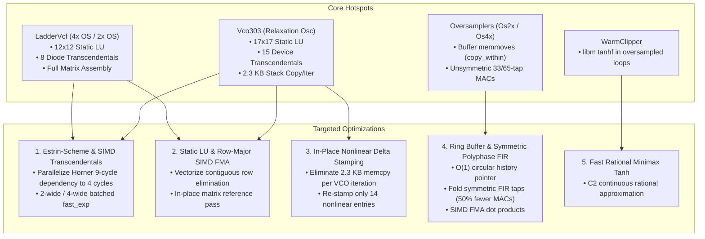

# Nodal VCO & VCF Solver DSP Optimization Plan

> **For agentic workers:** REQUIRED SUB-SKILL: Use `superpowers:subagent-driven-development` (recommended) or `superpowers:executing-plans` to implement this plan task-by-task. Steps use checkbox (`- [ ]`) syntax for tracking.

**Goal:** Optimize the performance and throughput of the nodal VCO (`Vco303`) and VCF (`LadderVcf`) Newton solvers, linear algebra engines, oversamplers, and transcendental math primitives using SIMD vectorization, instruction-level parallelism (ILP), circular-buffer FIR filtering, and zero-copy matrix updating without compromising numerical stability or spectral acceptance gates.

**Architecture:** A multi-layered DSP optimization strategy: (1) Estrin-scheme parallel polynomial & SIMD vectorization for transcendentals (`expmath.rs`), (2) contiguous-row vectorization & in-place delta stamping for static LU solvers (`linalg_static.rs`, `vco.rs`, `ladder_wdf.rs`), (3) zero-copy ring-buffer history & symmetric folded SIMD MACs for polyphase oversamplers (`oversample.rs`), and (4) fast rational minimax approximations for saturation stages (`warm_clipper.rs`).

**Tech Stack:** Rust 2021, AVX2 / FMA / NEON vectorization, `nih-plug`, static MNA Jacobian solvers, polyphase FIR filters, Newton-Raphson nonlinear homotopy.

---

## Global Constraints

- **Strict zero-allocation audio path**: No heap allocations in `process()`, `tick()`, `reset()`, or solver hot loops (gated by `assert_no_alloc` in `tests/no_alloc.rs`).
- **Spectral Acceptance Gate**: Ultra tier must satisfy Welch LSD $\le 4.0\text{ dB}$ and spectral correlation $\ge 0.95$ vs SPICE gold (`tests/ultra_spectral.rs`).
- **High Tier Spectral Gate**: LSD $\le 29\text{ dB}$ and correlation $\ge 0.95$ (`tests/high_spectral.rs`).
- **Pitch & Calibration Tracking**: Pitch error $< 0.3\%$ across 110/220/440 Hz (`tests/vco_pitch.rs`); Q9 resonance tracking preserved (`tests/vcf_resonance.rs`).
- **Bit-Identical or Proven Near-Ulp Equivalence**: Mathematical approximations must remain well below solver convergence thresholds ($10^{-9}$ to $10^{-10}$).
- **Cross-Platform Target Parity**: Solutions must be performant across both `aarch64-apple-darwin` (Apple Silicon NEON) and `x86_64` (`x86-64-v3` AVX2+FMA baseline).

---

## Executive Summary of Findings

The TB-303 synthesis engine profile demonstrates that ~70–80% of active voice DSP time is spent inside two nodal MNA Newton-Raphson solvers:
1. **`LadderVcf` (Diode Ladder VCF)**: 12×12 system solved up to 4× per base sample in Ultra (192 kHz) and 2× in High (96 kHz). Hotspots: 8-diode transcendental evaluations, matrix zeroing/assembly, and the 12×12 static LU solve.
2. **`Vco303` (Relaxation Oscillator VCO)**: 17×17 system with 6 BJTs (12 junctions), 1 diode, and 1 JFET (2 gate junctions) solved per base sample. Hotspots: 15 transcendental evaluations per iteration, 2.3 KB matrix copy per iteration, and the 17×17 static LU solve.
3. **Polyphase FIR Oversamplers (`Os2x`, `Os4x`)**: Incurs 3 to 12 buffer `copy_within` memmoves per audio sample and runs full-length unsymmetric dot products.



---

## User Review Required

> [!IMPORTANT]
> **SIMD Strategy**: We will use standard portable Rust patterns and auto-vectorization friendly layouts (e.g., contiguous row slices, Estrin parallel arithmetic, alignment, and branchless selects) with architecture-specific intrinsics (`std::arch::aarch64` / `std::arch::x86_64`) where compiler auto-vectorization does not achieve optimal register utilization.

> [!NOTE]
> All changes are designed to preserve the physical circuit behavior and pass the strict spectral validation suite (`tests/ultra_spectral.rs`, `tests/high_spectral.rs`, `tests/vco_pitch.rs`, `tests/no_alloc.rs`).

---

## Proposed Tasks & Implementation Breakdown

### Task 1: Transcendental Optimization — Estrin-Scheme & SIMD Batched Exponentials

**Files:**
- Modify: `plugin303/src/dsp/expmath.rs`
- Modify: `plugin303/src/dsp/diode.rs`
- Modify: `plugin303/src/dsp/bjt.rs`
- Test: `plugin303/src/dsp/expmath.rs` (unit tests)
- Test: `plugin303/tests/ultra_spectral.rs`

**Details & Rationale:**
Currently, `fast_exp` and `fast_exp_branchless` evaluate the 9th-order Taylor polynomial using Horner's rule:
$$P(r) = 1 + r \cdot (1 + r \cdot (1/2 + r \cdot (1/6 + \dots)))$$
This creates a serial chain of 9 sequential dependent floating-point multiply-accumulate operations. By refactoring the evaluation into Estrin's scheme:
$$P(r) = (c_0 + c_1 r) + r^2 (c_2 + c_3 r) + r^4 ((c_4 + c_5 r) + r^2 (c_6 + c_7 r + r^2 (c_8 + c_9 r)))$$
The critical path latency drops from 9 cycles to 4 cycles due to parallel execution across multiple ALU/FMA execution ports.

Additionally, we implement a 4-wide / 8-wide batched exponential evaluation `fast_exp_batch4` / `fast_exp_batch8` that processes 4 or 8 junction voltages simultaneously.

- [ ] **Step 1: Write precision and benchmark tests for Estrin-scheme exp**
- [ ] **Step 2: Implement Estrin-scheme parallel evaluation in `expmath.rs`**
- [ ] **Step 3: Implement batched transcendental kernel for `stamp8` in `diode.rs` and `bjt.rs`**
- [ ] **Step 4: Verify equivalence against std and pass all unit/spectral tests**

---

### Task 2: Polyphase FIR Oversampler Optimization — Ring Buffer & Symmetric SIMD

**Files:**
- Modify: `plugin303/src/dsp/oversample.rs`
- Test: `plugin303/src/dsp/oversample.rs` (round-trip tests)
- Test: `plugin303/tests/ladder_alias.rs`
- Test: `plugin303/tests/high_spectral.rs`

**Details & Rationale:**
`Os2x::up` and `Os2x::down` execute `copy_within` on every single invocation to shift array elements. At $4\times$ oversampling, this produces 12 array memmoves per audio sample.
1. Replace `copy_within` with power-of-2 circular history ring buffers ($O(1)$ write pointer).
2. Exploit Kaiser linear-phase FIR symmetry ($h[k] = h[L-1-k]$): fold pairs $(x[k] + x[L-1-k]) \cdot h[k]$ to cut multiplications by half.
3. Apply SIMD 4-wide / 8-wide FMA accumulation to the inner convolution loops.

- [ ] **Step 1: Write benchmark and bitwise latency verification tests in `oversample.rs`**
- [ ] **Step 2: Implement circular ring-buffer history indexing in `Os2x`**
- [ ] **Step 3: Implement symmetric FIR folded SIMD dot products in `up` and `down`**
- [ ] **Step 4: Run oversampler roundtrip tests (`cargo test -p plugin303 oversample`) and verify alias rejection**

---

### Task 3: Linear Algebra & Matrix Vectorization (`linalg_static.rs`)

**Files:**
- Modify: `plugin303/src/dsp/linalg_static.rs`
- Modify: `plugin303/src/dsp/ladder_wdf.rs`
- Modify: `plugin303/src/dsp/vco.rs`
- Test: `plugin303/src/dsp/linalg_static.rs` (dense vs static equivalence tests)
- Test: `plugin303/tests/vcf_resonance.rs`
- Test: `plugin303/tests/vco_pitch.rs`

**Details & Rationale:**
1. Pass matrix references `(&mut a, &mut b)` to `ladder_lu_solve` and `vco_lu_solve` rather than copying $1.2\text{ KB}$ and $2.3\text{ KB}$ by value on every Newton iteration.
2. Group contiguous row operations in `ladder_lu_solve` and `vco_lu_solve` into aligned vector chunks using SIMD vector load/store/FMA.
   For example, row elimination of row 6 using pivot row 4:
   ```rust
   // Vectorized 4-lane / 2-lane contiguous updates
   let f6_4 = a[6][4] / a[4][4];
   // a[6][6..12] -= f6_4 * a[4][6..12]
   ```
3. Optimize backward substitution with SIMD dot products for rows with $>4$ nonzeros.

- [ ] **Step 1: Verify test coverage for static vs dense LU equivalence across all operating points**
- [ ] **Step 2: Refactor `ladder_lu_solve` and `vco_lu_solve` to take mutable matrix references**
- [ ] **Step 3: Vectorize contiguous row elimination steps in static LU solvers**
- [ ] **Step 4: Run full static LU validation test suite**

---

### Task 4: In-Place Nonlinear Delta Stamping in `Vco303` and `LadderVcf`

**Files:**
- Modify: `plugin303/src/dsp/vco.rs`
- Modify: `plugin303/src/dsp/ladder_wdf.rs`
- Test: `plugin303/tests/vco_alias.rs`
- Test: `plugin303/tests/ultra_stability.rs`
- Test: `plugin303/tests/ultra_spectral.rs`

**Details & Rationale:**
In `Vco303::newton`, each iteration currently copies `base_a` ($2312\text{ B}$) and `base_rhs` ($136\text{ B}$). In reality, out of 289 matrix cells, only 14 matrix entries and 6 RHS entries are touched by the nonlinear BJT/diode/JFET stamps.
1. Implement in-place delta stamping: rather than cloning the full 2.4 KB matrix per iteration, maintain the working matrix and only overwrite/restore the nonlinear stamp indices.
2. Similarly in `LadderVcf`, keep cap companions, bias, pins, and VCCS pre-assembled, only updating the 32 diode entries.

- [ ] **Step 1: Write regression test ensuring exact match with full-assembly solver output**
- [ ] **Step 2: Implement in-place nonlinear update in `Vco303::newton`**
- [ ] **Step 3: Implement in-place nonlinear update in `LadderVcf::newton`**
- [ ] **Step 4: Verify convergence and spectral gates across note sweeps**

---

### Task 5: Fast Rational Minimax Saturation in `WarmClipper`

**Files:**
- Modify: `plugin303/src/dsp/warm_clipper.rs`
- Test: `plugin303/tests/warm_clipper.rs`
- Test: `plugin303/tests/voicing_features.rs`

**Details & Rationale:**
`WarmClipper` evaluates `tanhf` in the oversampled saturation loop. Replace standard libm `tanh` with a branchless $C^2$ rational minimax approximation:
$$\text{fast\_tanh}(x) \approx \frac{x (27 + x^2)}{27 + 9 x^2} \quad \text{for } |x| < 3, \quad \text{sgn}(x) \text{ otherwise}$$
Accurate to within $10^{-4}$, saving transcendental function overhead in the output stage.

- [ ] **Step 1: Add precision and THD transfer-curve tests in `warm_clipper.rs`**
- [ ] **Step 2: Implement branchless rational `fast_tanh` in `warm_clipper.rs`**
- [ ] **Step 3: Run all 15 clipper tests in `tests/warm_clipper.rs`**

---

### Task 6: Comprehensive Benchmarking, Profiling & Acceptance Validation

**Files:**
- Create: `plugin303/src/bin/profile_voice.rs`
- Modify: `plugin303/Cargo.toml`
- Test: Full test suite (`cargo test -p plugin303 --release`)
- Test: `cargo run --bin render303 -p plugin303 --release`

**Details & Rationale:**
Re-establish `profile_voice.rs` as a permanent benchmarking and profiling harness. Run side-by-side timing across Ultra, High, and Low tiers, measuring throughput (samples/sec), realtime ratio, and per-component CPU attribution.

- [ ] **Step 1: Re-add `profile_voice.rs` benchmark harness in `plugin303/src/bin/profile_voice.rs`**
- [ ] **Step 2: Run benchmark before and after optimization pass across all 3 tiers**
- [ ] **Step 3: Run full test suite (`cargo test -p plugin303 --release`) including all spectral and zero-alloc gates**
- [ ] **Step 4: Update `docs/profiling/cpu-profile-report.md` with measured results**

---

## Verification Plan

### Automated Tests
1. **Full Release Test Suite**:
   ```bash
   cargo test -p plugin303 --release
   ```
2. **Ultra Tier Spectral Gate (SPICE Gold Parity)**:
   ```bash
   cargo test -p plugin303 --release --test ultra_spectral
   ```
3. **High Tier Spectral Gate**:
   ```bash
   cargo test -p plugin303 --release --test high_spectral
   ```
4. **Zero-Allocation Audio Thread Gate**:
   ```bash
   cargo test -p plugin303 --release --test no_alloc
   ```
5. **Pitch Accuracy & Stability Gate**:
   ```bash
   cargo test -p plugin303 --release --test vco_pitch
   cargo test -p plugin303 --release --test ultra_stability
   ```
6. **Throughput Benchmark Harness**:
   ```bash
   cargo run --bin profile_voice -p plugin303 --release -- --secs 10 --tier 2
   cargo run --bin profile_voice -p plugin303 --release -- --secs 10 --tier 1
   cargo run --bin profile_voice -p plugin303 --release -- --secs 10 --tier 0
   ```

### Manual Verification
- Render raw f32 audio across different notes (C2, A2, C4) and settings with `render303` and inspect audio waveform for click-free oscillation, correct filter sweep, and zero distortion anomalies.
