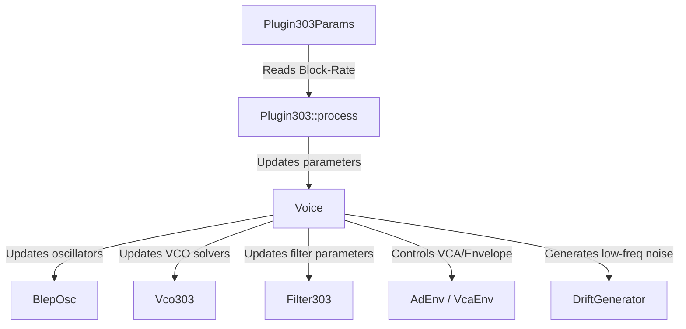

# Plan: Exposing TB-303 Front Panel & Souped-up Parameters in Plugin303

This revised plan details how we will expose the complete set of classic Roland TB-303 front panel parameters alongside the new "souped-up" parameters, wire them to the voice and sequencer engines (Low, High, and Ultra tiers), and implement support for all features:
- Dual oscillators with pitch offsets
- Oscillator 1 waveform select (Saw, Square, Sweep), pulse-width (PW), and sub-oscillator volume
- VCA envelope (Gate vs. AD decay)
- VCF Cutoff, Resonance, Env Amount, Env AD (Attack & Decay), Drive, and Taps (2-pole / 3-pole / 4-pole)
- Component Age and Component Drift

---

## Front Panel Controls (Classic & Souped-up)

We will define parameters in `Plugin303Params` to fully cover the classic TB-303 front panel and all advanced extensions:

### 1. Classic Front Panel Controls
- **Tuning** (`tuning`): `FloatParam`, range `-100.0..100.0` cents, default `0.0`. Fine-tunes overall pitch.
- **Cutoff Freq** (`cutoff`): `FloatParam`, range `0.0..1.0`, default `0.5`. Sets base VCF cutoff.
- **Resonance** (`resonance`): `FloatParam`, range `0.0..1.0`, default `0.5`. Sets VCF resonance.
- **Env Mod** (`env_mod`): `FloatParam`, range `0.0..1.0`, default `0.5`. Scales MEG envelope modulation of VCF cutoff.
- **Decay** (`decay`): `FloatParam`, range `0.0..1.0`, default `0.5`. Classic dual decay knob (controls both MEG and VEG decays simultaneously, unless advanced mode is active).
- **Accent** (`accent`): `FloatParam`, range `0.0..1.0`, default `0.5`. Controls the depth of accented step volume/cutoff boosts.
- **Waveform** (`waveform`): `EnumParam<OscWave>` (Saw / Square / Sweep), default `Saw`.
- **Volume** (`volume`): `FloatParam`, range `-90.0..6.0` dB, default `0.0` dB. Master output level.

### 2. Built-in Sequencer Controls
- **Sequencer Run** (`seq_run`): `BoolParam`, default `true`. Starts/stops the internal 16-step sequencer.
- **Sequencer Sync** (`seq_sync`): `BoolParam`, default `true`. Syncs sequencer to host transport clock.
- **Sequencer Tempo** (`seq_tempo`): `FloatParam`, range `40.0..300.0` BPM, default `120.0`. For standalone/sync-off play.
- **Sequencer Length** (`seq_length`): `IntParam`, range `1..16`, default `16`.
- **Sequencer Pattern**: We will declare a serializable step-pattern structure and register it under nih-plug's persistence state:
  ```rust
  #[derive(Serialize, Deserialize, Clone, Debug)]
  pub struct SequencerStep {
      pub semitone: i8,      // 0..12
      pub octave: i8,        // -2..2
      pub gate: StepGate,    // Rest, Note, Tie
      pub accent: bool,
      pub slide: bool,
      pub gate_len: f32,     // 0.0..1.0
      pub velocity: f32,     // 0.0..1.0
  }
  ```

### 3. Advanced & "Souped-up" Parameters
- **Oscillator 1 Pitch Offset** (`osc1_pitch`): `FloatParam`, range `-24.0..24.0` (semitones), default `0.0`.
- **Oscillator 2 Pitch Offset** (`osc2_pitch`): `FloatParam`, range `-24.0..24.0` (semitones), default `0.0`.
- **Oscillator 2 Volume/Mix** (`osc2_vol`): `FloatParam`, range `0.0..1.0`, default `0.0` (keeps it silent by default to match classic single-oscillator 303).
- **Oscillator 1 Pulse-Width (PW)** (`osc1_pw`): `FloatParam`, range `0.1..0.9`, default `0.5`.
- **Sub-oscillator Volume** (`sub_vol`): `FloatParam`, range `0.0..1.0`, default `0.0`.
- **Sweep Morph Position** (`sweep_pos`): `FloatParam`, range `0.0..1.0`, default `0.0`.
- **VCF Tap Select** (`vcf_taps`): `EnumParam<VcfTaps>` (2-pole / 3-pole / 4-pole), default `4-pole`.
- **VCF Drive** (`vcf_drive`): `FloatParam`, range `0.0..24.0` dB, default `0.0` dB.
- **Glide Time** (`glide`): `FloatParam`, range `0.0..1.0`, default `0.5`. Controls the slew rate of pitch slides.
- **Advanced Env Mode** (`advanced_env`): `BoolParam`, default `false`. Reveals full ADSR controls for MEG and VEG:
  - **MEG ADSR**: `meg_attack`, `meg_decay_adj`, `meg_sustain`, `meg_release`
  - **VEG ADSR**: `veg_attack`, `veg_decay_adj`, `veg_sustain`, `veg_release`
- **Component Age** (`comp_age`): `FloatParam`, range `0.0..1.0`, default `0.0`.
- **Component Drift** (`comp_drift`): `FloatParam`, range `0.0..1.0`, default `0.0`.

---

## User Review Required

> [!IMPORTANT]
> **Performance Optimization for Ultra Tier:**
> Running a second nodal circuit VCO (`Vco303`) for the second oscillator in the Ultra tier will double its Newton solver CPU cost. To prevent CPU overruns, we will implement an optimization: if `osc2_vol` is set to `0.0`, the second oscillator (both `BlepOsc` and `Vco303`) will skip rendering entirely.
>
> **Circuit VCO vs. PW modulation:**
> The Ultra-tier `Vco303` is a physical solver of the exact 303 VCO circuit. Adjusting pulse-width (PW) in the circuit model requires modifying physical resistors/capacitors in the MNA solver, which is not designed for real-time parameter sweeps. Therefore, the `osc1_pw` parameter will drive the PolyBLEP pulse oscillator in the Low/High tiers, but the Ultra tier's circuit VCO will output its native, circuit-accurate pulse waveform (node `O_P`).

---

## Proposed Changes

We will modify the parameter definitions, the filter trait, the DSP oscillators, the voice coordinator, and the main plugin wrapper.



### Component: Parameters

#### [MODIFY] [params.rs](file:///Users/gus/Git/vibe303/plugin303/src/params.rs)
We will define the new parameters in `Plugin303Params` using standard nih-plug parameter types. We will also implement serialization/deserialization for the sequencer pattern.

---

### Component: DSP Oscillators

#### [MODIFY] [osc.rs](file:///Users/gus/Git/vibe303/plugin303/src/dsp/osc.rs)
We will expand `Saw` into a unified `BlepOsc` capable of producing PolyBLEP Saw, Square (PWM), and Sweep:

- For Saw: Output standard PolyBLEP sawtooth.
- For Square: Implement PolyBLEP square/pulse wave. The naive pulse wave with duty cycle $w$ is $p(t) = 1.0$ if $t < w$ else $-1.0$. To prevent DC offset, we subtract $(2w - 1)$ from the output. We apply the PolyBLEP step correction of magnitude $+2.0$ at the wrap-around $t = 0$, and a correction of magnitude $-2.0$ at the transition $t = w$.
- For Sweep: Output a continuous linear interpolation between the PolyBLEP Saw and the PolyBLEP Square (based on a morph parameter).

```rust
pub struct BlepOsc {
    phase: f32,
    inc: f32,
    pw: f32,
    wave: OscWave,
}
```

#### [MODIFY] [vco.rs](file:///Users/gus/Git/vibe303/plugin303/src/dsp/vco.rs)
We will update `Vco303` to support output waveform selection:

- Expose a `pub fn tick_wave(&mut self, wave: OscWave) -> f32` method.
- Read the physical pulse output node `O_P` from the solver (node 16) and apply the rate-invariant DC-blocker.
- When `OscWave::Sweep` is selected, linearly interpolate between `v[O_R]` (saw) and `v[O_P]` (pulse).

> [!WARNING]
> **LUT Cache Invariant:**
> Component age and drift must NOT trigger a rebuild of the process-global frequency-to-CV look-up table (`cv_lut`), which is slow and would violate the real-time safety of the audio thread. Instead, aging and drift tuning shifts must be applied to the note frequency *before* calling `set_freq` or by adjusting the resulting frequency scaled parameters.

---

### Component: Filters

#### [MODIFY] [filter.rs](file:///Users/gus/Git/vibe303/plugin303/src/dsp/filter.rs)
We will extend the `Filter303` trait with a tap configuration method:
```rust
pub trait Filter303 {
    fn set_cutoff(&mut self, hz: f32);
    fn set_reso(&mut self, r: f32);
    fn tick(&mut self, x: f32) -> f32;
    fn reset(&mut self);
    fn set_poles(&mut self, n: usize) {} // default no-op
}
```

#### [MODIFY] [ladder_wdf.rs](file:///Users/gus/Git/vibe303/plugin303/src/dsp/ladder_wdf.rs)
We will add `poles: usize` to the `LadderVcf` struct and implement pole tap selection in `solve_sample`:

- For 4-pole: Read diff `v[TL] - v[TR]` (default).
- For 3-pole: Read diff `v[AL] - v[AR]`.
- For 2-pole: Read diff `v[BL] - v[BR]`.
- For 1-pole: Read diff `v[CL] - v[CR]`.

This maps directly to the physical diode-ladder stages, with matching DC gains due to the constant bias current.

---

### Component: Voice & Modulation

#### [NEW] [drift.rs](file:///Users/gus/Git/vibe303/plugin303/src/dsp/drift.rs)
We will implement a zero-allocation low-frequency random walk generator to emulate component drift:
```rust
pub struct DriftGenerator {
    state: u32,
    value: f32,
}

impl DriftGenerator {
    pub fn new(seed: u32) -> Self {
        Self { state: seed, value: 0.0 }
    }
    
    pub fn tick(&mut self, cutoff_hz: f32, sr: f32) -> f32 {
        // LCG PRNG step
        self.state = self.state.wrapping_mul(1103515245).wrapping_add(12345);
        let noise = ((self.state as f32) / (std::u32::MAX as f32)) * 2.0 - 1.0;
        // Lowpass filter to sub-audio rate
        let alpha = (2.0 * std::f32::consts::PI * cutoff_hz / sr).min(1.0);
        self.value += alpha * (noise - self.value);
        self.value
    }
}
```

#### [MODIFY] [voice.rs](file:///Users/gus/Git/vibe303/plugin303/src/dsp/voice.rs)
We will update `Voice` to orchestrate all these new components:

- Add a second oscillator (`osc2`, `osc2_hi`, `vco2`) and a sub-oscillator (`sub_osc`, `sub_osc_hi`).
- Add two `DriftGenerator` instances (one for VCO pitch, one for VCF cutoff).
- Implement `comp_drift` mapping:
  - Pitch drift: Fluctuate oscillator frequencies independently by up to $\pm 50$ cents.
  - VCF Cutoff drift: Fluctuate VCF cutoff by up to $\pm 15\%$.
- Implement `comp_age` mapping:
  - Keyboard tracking stretch: skew pitch tracking slightly.
  - Cutoff frequency shift: permanently shift the brightness calibration by up to $-15\%$.
  - Resonance reduction: scale down the maximum resonance by up to $-20\%$.
- Implement VCF Drive: Multiply the filter input signal by the drive amount (scaling the VCCS input node in High/Ultra, and scaling input to TptLadder in Low).
- Implement VCA Env mode: if Gate mode is active, override VCA envelope with $1.0$ (when note is active) else decay.

#### [NEW] [sequencer.rs](file:///Users/gus/Git/vibe303/plugin303/src/dsp/sequencer.rs)
We will implement the 16-step sequencer engine:
- Track current step and clock boundaries based on host PPQ/Tempo (or internal tempo fallback).
- Handle glide logic: if `slide` is active between steps, keep the envelope gate open and enable pitch slew (glide).
- Handle accent logic: trigger the accent decay curve, which shortens filter decay and boosts volume and VCF cutoff.

---

### Component: Plugin Scaffold

#### [MODIFY] [lib.rs](file:///Users/gus/Git/vibe303/plugin303/src/lib.rs)
In the sample-processing loop in `Plugin303::process`, read all parameters from `self.params` once per block, and apply them to `self.voice`.

---

## Verification Plan

### Automated Tests
We will add new unit and integration tests to verify correctness and safety:

1. **Oscillator Test (`tests/osc_params.rs`)**:
   - Verify that PolyBLEP square outputs zero-DC waveforms.
   - Verify that `osc1_pw` modulates the duty cycle.
   - Verify that sub-oscillator operates exactly one octave below the master frequency.
2. **Filter Tap Test (`tests/vcf_taps.rs`)**:
   - Verify that 2-pole, 3-pole, and 4-pole taps in both `TptLadder` and `LadderVcf` produce $-12$, $-18$, and $-24$ dB/octave attenuation slopes respectively.
3. **Age & Drift Test (`tests/age_drift.rs`)**:
   - Verify that enabling drift creates pitch fluctuations over time.
   - Verify that age stretches keyboard pitch tracking and shifts filter corner.
4. **Sequencer Test (`tests/sequencer.rs`)**:
   - Verify step advance on 16th boundaries.
   - Verify slide triggers glide slew and bypasses retrigger.
5. **No-Allocation Audio Thread Gate (`tests/no_alloc.rs`)**:
   - Verify that the audio loop remains completely allocation-free with all these parameters dynamically changing.

Run the test suites:
```bash
cargo test -p plugin303
```

### Manual Verification
1. Rebuild and bundle the plugin:
   ```bash
   cargo xtask bundle plugin303 --release
   ```
2. Run the headless renderer to inspect offline wave files (checking morphing, PW, sub-osc, and age/drift):
   ```bash
   cargo run --bin render303 -p plugin303 -- --out /tmp/render_params.f32
   ```
