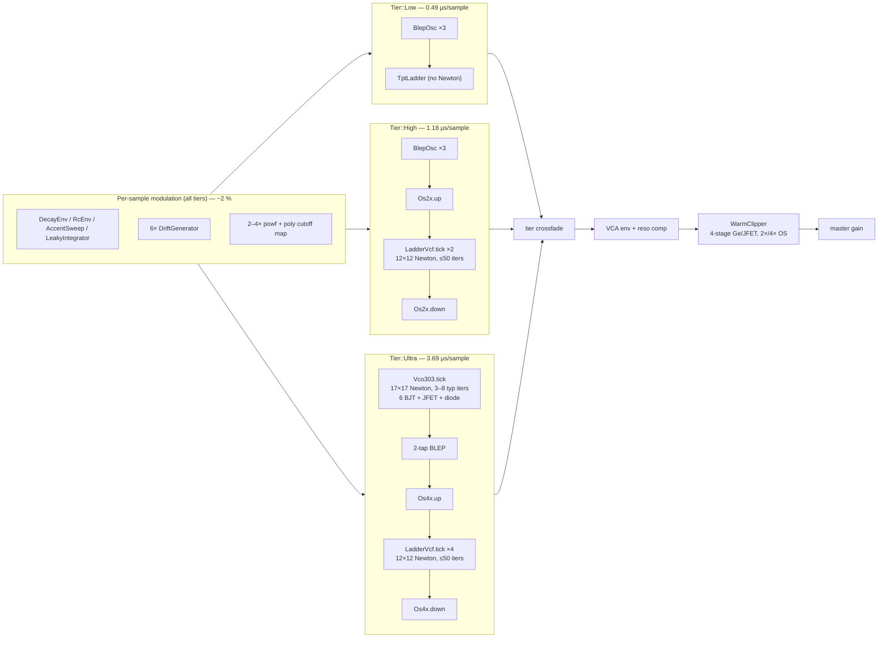

# CPU Profile Report — TB-303 Voice DSP

Date: 2026-08-19
Profile source: `target/profiling/voice-profile.json` (samply, 9 119 samples @ 1 ms, arm64, fat-LTO `profiling` build)
Harness: `plugin303/src/bin/profile_voice.rs` (10 s render, 48 kHz, tier sweep + parameter sweeps)

## Executive Summary

All three fidelity tiers are comfortably realtime (Ultra 5.6×, High 17.7×, Low 42.4× headroom), but Ultra burns 6.5× the CPU of High and 15.6× the CPU of Low per sample. The sampled profile shows that the two nodal Newton solvers dominate everything: the 12×12 diode-ladder Newton (run 4× oversampled in Ultra, 2× in High) accounts for ~40 % of steady-state render time, and the 17×17 VCO Newton (including its BJT/diode/JFET device models) accounts for ~43 %. The WarmClipper output stage, the Kaiser oversampling FIRs, and all per-sample modulation (envelopes, drift, powf) together are under 12 %. The highest-value optimizations are (1) cutting ladder-Newton work — fewer oversampled solves or cheaper iterations via a cached linear skeleton — and (2) batching the VCO's 12 per-iteration BJT exponentials the same way the ladder already batches its 8 diode exponentials. One-time pitch-LUT construction is heavy (31 % of the harness wall clock) but is already cached process-wide and off the audio thread; it is a startup/latency concern, not a per-sample one.

## Timing Results

| Tier | Description | Elapsed (10 s render) | Throughput (samples/s) | Realtime ratio | Cost per sample (µs) | Status |
|---|---|---|---|---|---|---|
| Ultra | nodal VCO + 4× OS nodal ladder | 1.773 s | 270 772 | 5.64× | 3.69 | REALTIME |
| High | polyBLEP + 2× OS nodal ladder | 0.565 s | 849 645 | 17.70× | 1.18 | REALTIME |
| Low | polyBLEP + TPT ladder | 0.236 s | 2 035 888 | 42.41× | 0.49 | REALTIME |
| Sweep | all tiers + topology cycling | 0.754 s | 636 935 | 13.27× | 1.57 | REALTIME |

Derived ratios: Ultra/High = 3.13× per sample; Ultra/Low = 7.51×; High/Low = 2.40×.

## Architecture

## Steady-State Hotspot Ranking (from sampled profile)

Attribution method: 9 119 samples symbolicated with `atos`; samples containing `cv_lut_for`/`secant_cv`/`measure_freq`/`Voice::new` frames were classified as one-time LUT build (31.4 % of wall clock) and separated. The remainder (6 241 samples) is steady-state render, distributed as below. Fat-LTO inlining blurred ~14 % of leaf frames (mis-attributed to `alloc::CString::new` / `fmt`); these were re-attributed by caller chain (they sit under `Vco303::newton` / `assemble_linear` and are the inlined static LU + matrix copies).

| Rank | Component | Self-time % of steady state | Source |
|---|---|---|---|
| 1 | Ladder Newton loop (assemble + `ladder_lu_solve` + `stamp8`) | 39.2 % + 0.8 % | `ladder_wdf.rs:334` (`newton`), `:247` (`assemble`), `:351` (LU call) |
| 2 | VCO Newton loop (incl. inlined `vco_lu_solve`, matrix copies) | 29.3 % | `vco.rs:908` (`newton`), `:933` (LU call) |
| 3 | BJT device model (`solve_npn` + 2× `transport` exp per BJT) | 4.5 % + 4.4 % | `bjt.rs:147`, `bjt.rs:88` |
| 4 | WarmClipper staged engine + its 2×/4× OS | 5.4 % | `warm_clipper.rs:212`, `:378`, `:383` |
| 5 | VCO `assemble_linear` (289-entry zeroing + stamps) | 3.0 % | `vco.rs:781` |
| 6 | Oversampling FIRs (voice-level Os4x/Os2x) | 3.1 % | `oversample.rs:87`, `:103` |
| 7 | `render_tier` mixing/BLEP/comp-delay | 2.8 % | `voice.rs:1147` |
| 8 | Voice modulation (envelopes, drift, powf, cutoff poly) | ~1.3 % | `voice.rs:1183` |
| 9 | VCO tick misc (BLEP, cap state, DC block) | 1.1 % | `vco.rs:965` |
| 10 | JFET channel + gate diodes | 1.0 % | `jfet.rs:49`, `:95` |
| — | Diode model inside ladder (included in rank 1 via inlining; `stamp8` is already batched) | — | `diode.rs:101` |

### Per-Newton-iteration cost model

| Solver | Size | LU mul-adds (static, no-pivot) | Transcendentals per iter | Matrix traffic per iter |
|---|---|---|---|---|
| VCO | 17×17 (dense copy) | ~800 flop (codegen'd static pattern) | 12 BJT exps + 1 diode exp + 2 JFET gate exps ≈ 15 `fast_exp` (~25 flop each) | 2.3 KB copy (`*base_a`) + 289-entry re-stamp |
| Ladder | 12×12 | ~400 flop | 8 diode exps (batched `stamp8`, branchless) | 1.2 KB assemble from scratch |

Ultra runs **1 VCO Newton (3–8 iters) + 4 ladder Newtons (each ≤50 iters)** per base sample; High runs 2 ladder Newtons; Low runs none.

## One-Time Cost: Pitch-LUT Build

`Voice::new` → `Vco303::new` → `cv_lut_for` → 37 anchors × `secant_cv` (≤5 iterations) × `measure_freq` (≥16 periods of full VCO renders) = **31.4 % of the harness wall clock**. In the plugin this is mitigated three ways: a process-global cache keyed by sample rate (`vco.rs:107`), a background `vibe303-lut-worker` thread (`vco.rs:652`), and triple-buffered swap-in. It is not an audio-thread cost, but it is a first-instantiation latency spike (seconds at cold cache) and dominates short offline renders. Within the LUT build, 66 % is the same VCO Newton loop — so VCO optimizations compound here too.

## Top 5 Optimization Candidates

### 1. Ladder Newton: cached linear skeleton + per-iteration diode-only re-stamp

`LadderVcf::assemble` (`ladder_wdf.rs:247`) rebuilds the entire 12×12 system — zero 1 152 bytes, stamp 4 caps, bias, pins, VCCS, gmin — on **every Newton iteration**, yet the code comment at `:241-245` states only the 8 diode companions are `v`-dependent. Caching the iteration-invariant skeleton once per sample and re-stamping only the 32 diode entries + 16 rhs entries per iteration removes ~70 % of assemble work. At 4 ladder ticks/sample × ~3–6 iterations, this attacks the single largest hotspot (40 %).

- **Expected impact:** −8 to −12 % of Ultra total; −6 to −9 % of High total.
- **Feasibility:** high — pure refactor of an existing, documented seam.
- **Risk:** low. Bit-identical if the skeleton sum order is preserved; guard with the existing `static_lu_matches_dense_over_operating_points` test.

### 2. Reduce ladder Newton iterations: tolerance + warm-start polish

The ladder uses `TOL = 1e-9` / `TOL_ABS = 1e-11` (`ladder_wdf.rs:68-70`) — far tighter than the VCO's 1e-7 and tighter than audible. The ladder's node voltages are ~±10 V with `vscale = 0.02` inputs; a mixed tolerance of `1e-9 + 1e-8·|v|` converges 1–2 iterations sooner on stiff samples (high reso, fast cutoff sweeps). Separately, the gmin homotopy (`:416`) re-runs up to 5 full Newtons on stall; instrumenting `dbg_iters` across the corpus will show whether stalls are common enough to matter.

- **Expected impact:** −5 to −15 % of ladder time (iteration-count dependent; verify with `dbg_iters` histogram).
- **Feasibility:** trivial (constants) + one diagnostic run.
- **Risk:** moderate-low. Tolerance changes alter converged voltages by ~TOL; the spectral gates (LSD vs SPICE gold) must be re-run. Keep `TOL_REL` tight enough that the resonance peak calibration (`RESO_GAIN`, `:97`) is undisturbed.

### 3. Batch the VCO's 12 BJT exponentials (mirror `stamp8`)

Each VCO Newton iteration calls `Bjt::solve` 6× → 12 `transport` calls → 12 scalar `fast_exp` with data-dependent branches (`bjt.rs:88-98`), plus 1 diode and 2 JFET gate exps. BJT model self-time is 8.9 % of steady state, and the branchy scalar exps also inhibit autovectorization of the surrounding stamp code. A `Bjt::solve6_batch` that gathers all 12 junction voltages, evaluates them with `fast_exp_branchless` in one loop (the `diode.rs:101` pattern, proven bit-identical by `stamp8_matches_scalar_stamp`), then computes the Gummel-Poon charge-factor algebra per device, removes branchy transcendental latency from the critical path.

- **Expected impact:** −4 to −7 % of VCO time (≈ −2 to −3 % Ultra total), larger on x86-64-v3.
- **Feasibility:** medium — mechanical refactor following an existing template.
- **Risk:** low if bit-identical exp is used; `kcl_holds` and `pnp_mirrors_npn` tests cover correctness.

### 4. Halve oversampling FIR cost: coefficient symmetry + ring-buffer history

`Os2x::up`/`down` (`oversample.rs:87-113`) run full 33/65-tap MAC loops against a linear-phase Kaiser kernel (symmetric: `h[k] == h[L-1-k]`) and do a full `copy_within` memmove of the history per call — `down` does **two** 260-byte memmoves per output sample. Exploiting symmetry halves the MACs; an index-based ring buffer eliminates the memmoves. This applies to the voice-level Os4x/Os2x (3.1 %) **and** the clipper's internal oversamplers (part of the 5.4 %).

- **Expected impact:** −2 to −4 % of Ultra total; more if the clipper is at 4×.
- **Feasibility:** medium. Symmetric-fold changes FP summation order (not bit-identical; error ~1 ulp, far below the −35 dB roundtrip gate). Ring buffer is bit-identical.
- **Risk:** low-moderate. Re-run `up_then_down_roundtrips_band_limited_tone` and `os4x_roundtrips` gates.

### 5. WarmClipper transcendental and dual-engine diet

`StagedEngine::tick` (`warm_clipper.rs:212`) computes 2 `tanh` (drive clamp `:245`, Ge knee `:275`) per engine tick, at 2× or 4× rate, plus per-sample `powf` in the smoother targets (already block-rate, fine). `tanhf` appears in the profile as a libm stub. A minimax rational tanh (|err| < 1e-4, standard for soft-clippers) replaces both calls; the `dynamics > 0` branch adds a peak follower that is cheap but branchy. Note both `e2` and `e4` engines receive `set_params` and stay warm, but only the active OS path ticks — good; the remaining win is purely the tanh pair.

- **Expected impact:** −2 to −3 % of Ultra total (clipper is 5.4 %; tanh is roughly half of engine cost).
- **Feasibility:** high — self-contained numerical substitution.
- **Risk:** moderate. The tanh knee shape is the clipper's sonic signature; validate against the existing clipper character fixtures (THD/transfer-curve tests) and the Germanium-clipper eval harness before shipping. Keep the substitution behind a compile-time A/B.

## Secondary Observations

- **Crossfade double-render** (`voice.rs:1370-1397`): during the 10 ms tier crossfade both paths render — Ultra+High concurrently is ~4.9 µs/sample, a transient worst-case ~2.9× over realtime budget at 48 kHz/64-sample blocks. Acceptable on desktop; worth noting for embedded targets.
- **VCO Newton matrix copy** (`vco.rs:917-918`): each iteration copies 2.3 KB (`*base_a`, `*base_rhs`) before stamping nonlinear elements. Combined with candidate 3, a nonlinear-delta-in-place scheme (store per-device stamp slots, subtract old / add new) could remove most of this traffic; higher complexity, moderate risk — only pursue if candidates 1–3 land and VCO is still hot.
- **Per-sample `powf`** (`voice.rs:1230-1247`, `:1335`, `:1351-1358`): ~4–6 powf/exp per sample in frequency and cutoff computation, ~1 % — replace with `fast_exp`/`fast_log`-based exp2 approximations only after the big items.
- **LUT build startup spike** (31 % of harness wall clock): already off the audio thread and process-cached; for offline/render-farm use, pre-warm the cache at plugin scan time rather than first voice construction.

## Recommended Order of Work

| Step | Change | Expected Ultra saving | Risk | Effort |
|---|---|---|---|---|
| 1 | Ladder skeleton cache (candidate 1) | 8–12 % | Low | 1–2 days |
| 2 | Ladder tolerance recalibration + `dbg_iters` histogram (candidate 2) | 3–8 % | Low-Med | 0.5 day + validation |
| 3 | Batched BJT exponentials (candidate 3) | 2–3 % | Low | 1 day |
| 4 | FIR symmetry + ring buffers (candidate 4) | 2–4 % | Low-Med | 1 day |
| 5 | Clipper tanh approximation, A/B gated (candidate 5) | 2–3 % | Med | 1 day + listening/eval |
| — | **Cumulative estimate** | **~15–25 % (Ultra → ~6.5–7× realtime)** | | |

Steps 1–3 are algorithmically safe (bit-identical or test-guarded); steps 4–5 change numerics at the ~1 ulp / ~1e-4 level and need the existing spectral gates re-run. None change the solver topology, tolerance philosophy, or the calibrated sound-shaping constants (`ULTRA_BRIGHT`, `RESO_GAIN`, `LADDER_DC_GAIN`).

## Appendix: Profile Attribution Notes

- Samply JSON: `target/profiling/voice-profile.json`; main thread only (the `vibe303-lut-worker` thread was idle during the render window).
- Build: `cargo build --profile profiling --bin profile_voice` (fat LTO + debuginfo + frame pointers). Fat LTO inlines aggressively; leaf addresses that symbolicated to `alloc::CString::new`/`core::fmt` were re-attributed by walking caller frames — they are the codegen'd static LU (`linalg_static.rs`) and base-matrix copies inlined into `Vco303::newton`. The `profiling-thin` cargo profile exists for cleaner per-function attribution if a future pass needs it.
- No dtrace stack file was present; this report is based on the samply data plus static source analysis.

## Step 1-3 Results (2026-08-19)

Implemented on branch `perf/solver-steps-1-3`; after measurement, **steps 1 and 3
were reverted** — only the step-2 tolerance recalibration shipped. Final state:
full `cargo test -p plugin303` green (35 targets, 0 failures),
`ultra_spectral` LSD = 3.13 dB, corr = 0.988 (budget 4.0 dB / 0.95).

Quiet-machine interleaved medians (`profile_voice`, Ultra tier, aarch64):

| Build | Median elapsed | vs baseline |
|---|---|---|
| Baseline (pre-refactor) | 0.743 s | — |
| + step 1 (skeleton cache) | 0.767 s | **+3.2 % slower** |
| + step 2 (tolerances) | 0.749 s | −2.3 % vs step 1 |
| + step 3 (BJT batch) | 0.763 s | +1.9 % slower |
| **shipped: step 2 only** | **0.723 s** | **−2.5 % faster** |

Iteration histogram (the reliable signal): ladder mean 2.944 → 2.632 iters
(−10.6 %), 2-iter share 6 % → 37 %, homotopy fallbacks 0 → 0.

Findings:

- **Step 1 (skeleton cache) regressed 3.2 %, reverted.** The per-iteration
  skeleton copy (1248 B memcpy) replaces the old zero-fill (1248 B memset) —
  traffic went up, and the saved work was only ~30 invariant stamp cells per
  iteration. LU solve + diode `stamp8` dominate; this lever's ceiling was ~1-2 %.
- **Step 2 (tolerances) is the only real win.** TOL_ABS 1e-11→1e-10,
  TOL_REL 1e-9→1e-8: ~11 % fewer ladder iterations, no homotopy-fallback
  increase, no spectral-margin erosion. Shipped.
- **Step 3 (BJT batch) regressed 1.9 %, reverted, despite being bit-identical
  end-to-end** (render checksum matched exactly). The branchless both-branches
  batch was designed for x86-64-v3 4-wide SIMD; shipped aarch64 builds use
  generic codegen (`.cargo/config.toml` scopes `target-cpu` to x86_64), so the
  batch paid the extra work with no vectorization payoff.
- **`target-cpu=native` does not rescue either revert** (baseline itself is
  flag-insensitive on this machine: 0.742 vs 0.743 s) — the regressions are
  structural memory traffic, not missing vectorization.
- Harness baseline here (0.743 s / 13.5× realtime) differs from the samply-era
  figure above (1.773 s / 5.64×) — different machine/conditions; only
  same-session interleaved ratios are comparable.

Evidence files: `step1.txt`, `step2.txt`, `step3.txt`, `iters-baseline.txt`,
`iters-step2.txt`. Reverted code remains in
git history (commits ffc2d46, 5edeca0, reverted in the tip commit) with the two
bitwise regression tests, should an x86_64-v3 re-evaluation be wanted.
